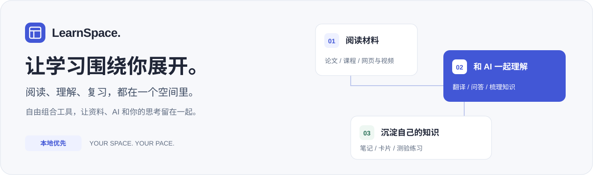
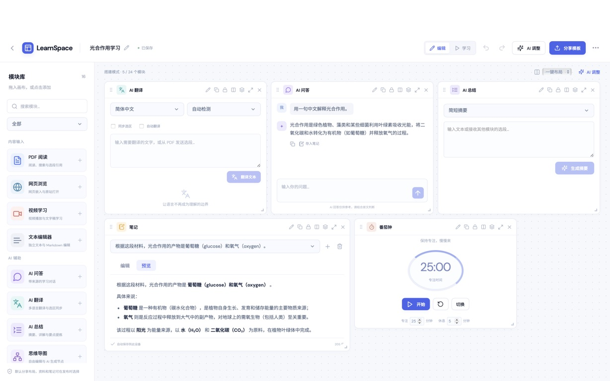
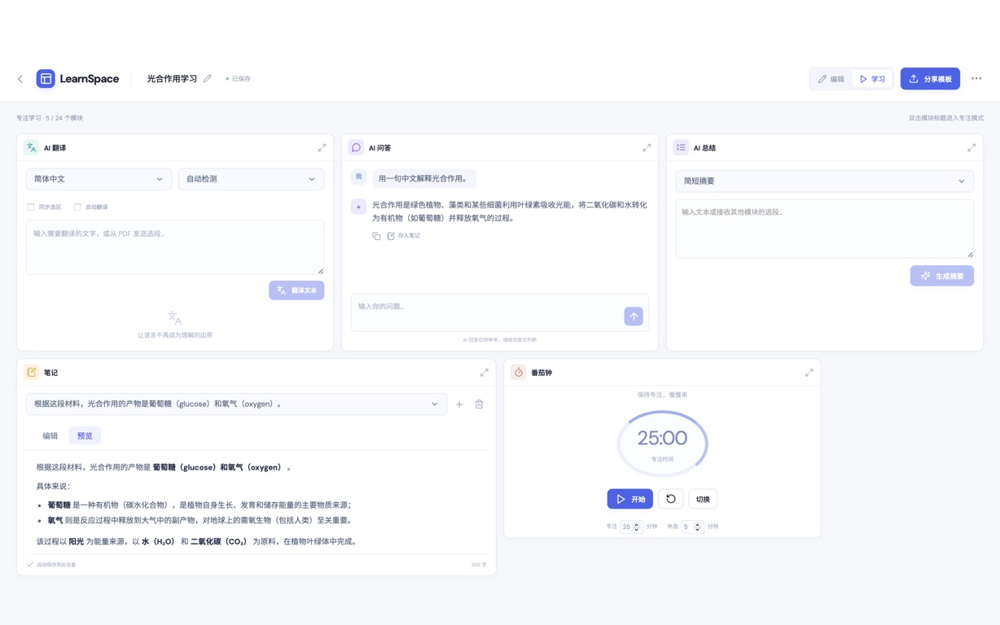
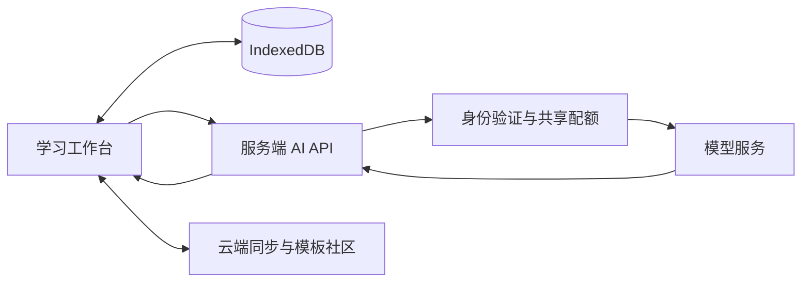

<div align="center">

# LearnSpace

**自由搭建你的 AI 学习空间**

把资料、AI 工具与笔记放在一起，让空间适应你的学习方式。

[**打开 LearnSpace ↗**](https://learnspace-lake.vercel.app/) · [开始使用](#开始使用) · [本地运行](#本地运行) · [部署指南](docs/vercel-deployment.md)

[](https://learnspace-lake.vercel.app/)


</div>



## 从一份资料，到真正理解

读一篇论文时，原文、译文、问题和笔记应该能同时看见。复习一门课程时，同一份材料又可以变成知识卡片、测验和思维导图。

LearnSpace 把这些学习工具放进可自由组合的工作台。你决定工具放在哪里、哪些内容值得留下；AI 帮你理解材料、梳理知识与检验掌握情况。

| 你的空间 | 连贯的学习过程 | 留得住的知识 |
| :--- | :--- | :--- |
| 拖拽组合、调整大小，随时专注一个模块。 | 从原文选段进入翻译与问答，保留来源线索。 | 将回答存入笔记，再制作卡片和练习。 |

## 选一种方式，开始学习

| 场景 | 可以这样组织工作台 |
| :--- | :--- |
| **精读一篇论文** | 文件阅读 + 翻译 + 问答 + 笔记，原文和思考并排放。 |
| **准备一次考试** | 课程资料 + 思维导图 + 知识卡片 + 测验，从理解走到自测。 |
| **学习一段视频** | 视频 + 自备文字稿 + 问答 + 笔记，把疑问和收获留在旁边。 |

### 空间由你安排

从空白工作台开始，或选择内置模板。移动、缩放和堆叠模块，用一键布局快速整理；进入学习模式后收起搭建控件，也可以将任意模块放大专注阅读。

不确定怎么搭建时，直接告诉 AI：

> 下周组会要讲一篇英文论文，帮我安排一个适合精读和整理汇报要点的工作台。

**描述目标 → 预览和调整方案 → 确认应用。** 调整已有工作台时保留模块内容，布局操作支持撤销与重做。方案中的目标和步骤用于说明搭建思路，不是独立的任务管理系统。

### AI 围绕材料工作

- **选中就能继续学**：把文件选段发送到翻译、问答、笔记或卡片，也可以为模块选择多个材料来源。
- **边生成，边阅读**：问答、翻译和测验支持流式反馈。导图与测验可同时生成，并在离开当前工作台后继续处理；需保持网站页面打开，刷新或关闭页面会中断任务。
- **把收获留下来**：AI 回答与译文可存入笔记，自动提取标题；笔记支持 Markdown，卡片和测验支持数学公式。
- **找回上下文**：保留来源页码、版本和引用信息；AI 回答仍需结合原文判断。

### 学习内容由你掌握

工作台、文件和笔记默认保存在当前浏览器，自动保存。登录后可主动使用工作台云端同步与恢复；原始文件不会随私人工作台快照自动上传。

觉得一套工作台好用，就把它保存为本地模板，或发布到社区。**只公开你勾选的资料和笔记**；聊天记录与 AI 运行结果不会自动附带。其他人安装后获得独立副本，修改不会影响你的工作台。指定笔记、临时选区和检索关键词需要安装者重新选择。

<details>
<summary><strong>查看界面演示</strong></summary>

以下为早期版本的真实界面截图，使用合成学习材料。当前模块入口和文案已有调整，以在线版本为准。

**搭建空间**



**进入学习**



</details>

## 开始使用

1. [打开在线版](https://learnspace-lake.vercel.app/)，新建空白工作台或选择模板。
2. 添加文件阅读、笔记和需要的学习工具，上传资料或输入内容。
3. 登录后使用 AI 翻译、问答、导图、卡片与测验；也可以先搭建和手动学习。
4. 按需开启云端保存，或将可分享的模板发布到社区。

**当前模块**

| 内容来源 | 理解与整理 | 练习巩固 | 辅助工具 |
| :--- | :--- | :--- | :--- |
| 文件阅读、网页、视频、图片 | AI 问答、AI 翻译、笔记、思维导图 | 知识卡片、测验练习 | 待办、番茄钟、日历 |

文件阅读支持 PDF、DOC/DOCX、Markdown 与 TXT。兼容旧数据的文本、便签、总结及自定义 AI 类型仍保留在代码中，不作为当前模块库的新建入口。任务/助手侧栏和可视化牵线入口已移除，材料选择是当前的操作方式。

## 本地运行

需要 Node.js 与 npm。本次本地验证使用 Node.js 20.20.2。

```bash
git clone https://github.com/XiaoLidan-lab/learnspace.git
cd learnspace
npm ci
cp .env.example .env
npm run dev
```

打开终端显示的 Vite 地址，默认 `http://127.0.0.1:5173`。`/api` 会代理到本地 Express 服务。不配置云端也可使用本地工作台、资料和内置模板。

<details>
<summary><strong>配置 AI、Supabase 与数据库</strong></summary>

在 `.env` 填入配置，前后端指向同一个 Supabase 项目：

| 变量 | 用途 |
| :--- | :--- |
| `VITE_SUPABASE_URL` / `VITE_SUPABASE_ANON_KEY` | 浏览器使用的 Supabase 公共配置 |
| `SUPABASE_URL` / `SUPABASE_ANON_KEY` | 服务端验证登录身份 |
| `SUPABASE_SERVICE_ROLE_KEY` | 仅服务端调用 AI 共享配额 RPC |
| `AI_BASE_URL` / `AI_MODEL` | OpenAI 兼容接口地址与模型名称 |
| `AI_API_KEY` | 仅服务端使用的模型密钥 |
| `PORT` | 本地 API 端口，默认 3001 |

**不要提交 `.env`。模型密钥与 Service Role Key 不得添加 `VITE_` 前缀，也不得发送给浏览器。** Vercel 的 Production 和 Preview 需分别确认配置范围；缺少配额服务配置时，AI 请求会被拒绝，普通学习仍可使用。

- **新数据库**：审阅 [数据库基线](server/supabase.sql)，再补齐 [008 AI 配额](server/migrations/008_ai_quota.sql) 和 [011 社区材料兼容](server/migrations/011_community_learning_materials.sql)。[009](server/migrations/009_ai_user_concurrency.sql) 与 [010](server/migrations/010_ai_personal_budget.sql) 是可选的并发、个人预算策略调整。
- **已有数据库**：先核对实际结构和已应用迁移，再按依赖补齐缺失项。私人工作台依赖 005/006，V2 模板依赖 007，资料分享依赖 004，011 依赖 004/007。不要为每次部署重跑基线或旧迁移。
- **认证**：启用所需邮箱登录方式，在 Supabase Auth 配置准确的正式、本地及预览回调地址；邮件链接还依赖 SMTP 与发信限额。

详见 [部署指南](docs/vercel-deployment.md)、[AI 配额运维](docs/ai-quota-operations.md) 和 [社区材料兼容说明](docs/community-materials-compatibility.md)。

</details>

## 技术与验证

**React · TypeScript · Vite · Express · Supabase · IndexedDB · PDF.js · Zod · KaTeX**

浏览器负责学习界面和本地资料，服务端负责身份验证与模型调用，Supabase 提供认证、云端快照、社区、资料权限和共享配额。



AI 保护包含跨实例共享限流、并发控制、分操作输出 Token 上限及全站每日/累计准入预算。准入单位不是实际 Token 或人民币账单；供应商预算与告警需要另行核实。

```bash
npm test          # 本机单元与集成测试
npm run build     # TypeScript 检查与生产构建
npm start         # 运行已构建的本地生产版本
```

**2026-10-21 正式部署**：功能版本 `c9bd07d` 已发布到 Production；全量测试 **223/223 通过**，生产构建成功。上线检查覆盖首页、API 健康、匿名请求拦截与 JSON 错误响应；公开前端资源扫描未命中本次配置的服务端私密值。

本次部署未调用真实模型，也未执行真实业务写入测试。真实跨实例配额、供应商预算/告警、邮件回跳及备份恢复等检查仍需单独确认。历史联调记录不自动代表当前生产版本已完整复验。

`npm run test:live` 会访问真实服务、消耗模型额度并尝试数据库写入，必须明确授权后运行。常规自动化使用本机隔离夹具。

## 使用边界

- **本地优先**：浏览器站点数据被清理时，本地内容可能丢失；不同域名、设备的本地存储不互通，登出也不会擦除本机资料。
- **云端快照有边界**：私人快照有 5 MB 上限；原文件和本地模板不会自动随快照跨设备传输，模板 JSON 也不是完整资料备份。
- **外部内容有边界**：网页受跨域和嵌入策略影响；视频不提供通用自动转写或视觉理解，文字稿需自行提供。
- **来源需要判断**：PDF 引用可回跳页码，尚无精确选段高亮；AI 输出不代替原文核实。
- **设备体验有区别**：桌面适合自由布局，窄屏使用纵向排列与点击添加。

<div align="center">

**Your space. Your pace.**

[开始搭建自己的学习空间 →](https://learnspace-lake.vercel.app/)

</div>
