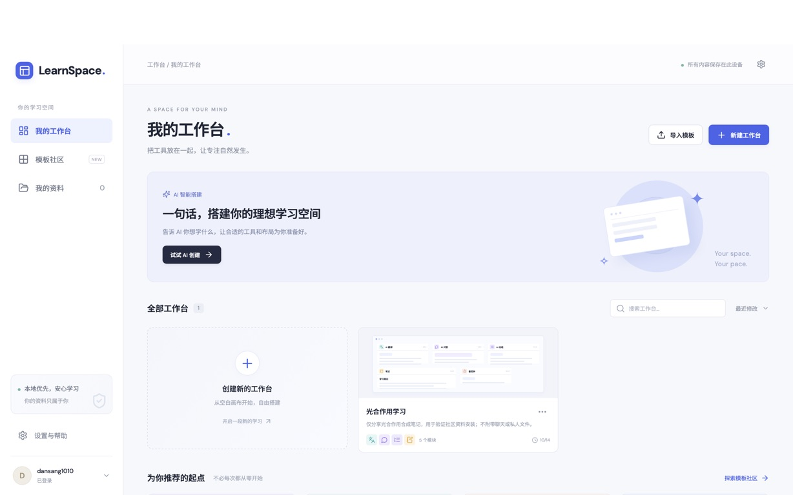
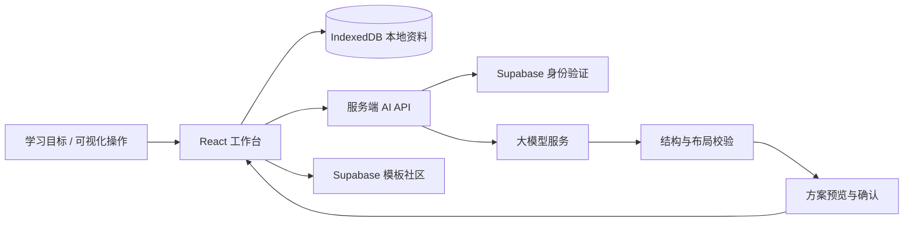

<div align="center">

# LearnSpace

### 自由搭建你的 AI 学习空间

把资料、AI 工具与笔记放在同一个工作台，让布局围绕你的学习任务展开。

[在线体验](https://learnspace-lake.vercel.app) · [快速开始](#快速开始) · [功能与架构](docs/implementation.md) · [部署指南](docs/vercel-deployment.md)

</div>



## 为什么做 LearnSpace？

阅读论文、学习课程或准备考试，往往需要在资料阅读、翻译、问答和笔记工具之间来回切换。不同任务需要的工具和空间也不一样：论文精读需要给原文更多位置，考试复习需要让知识卡片与测验更容易访问。

LearnSpace 将这些工具组织为可组合的模块。你可以自己拖拽搭建，也可以只告诉 AI **想完成什么任务**，由它拆分学习步骤、选择模块并生成布局，再由你预览和调整。

它是一个已上线的学习工作台项目，支持真实模型调用、浏览器本地保存，以及基于 Supabase 的模板社区。

## 界面展示

以下为实际运行页面截图，工作台内使用合成的光合作用学习材料展示功能。

### 搭建模式：让工具适应任务

从模块库添加工具，拖动标题移动、拖动右下角调整大小；支持分屏、标签堆叠、一键排版和布局撤销重做。


### 学习模式：理解、整理与复习放在一起

隐藏搭建控件，专注于资料和内容。AI 回答可以保存到笔记，Markdown 笔记支持编辑与预览；需要更大空间时，可进入单模块专注模式。


任务系统支持独立的笔记、卡片和测验状态；学习助手可汇总任务上下文问答、预览计划调整，并在任务完成后整理成果总结。步骤完成与掌握证据分别展示，计划修改始终需要用户确认。见[第三阶段开发记录](docs/task-assistant.md)。

## 核心能力

### 1. 可视化编排与模块组合

- **17 种模块、4 个类别**，支持同类型多实例；每个工作台最多 24 个模块。
- **12 列网格布局**，支持拖拽、缩放、对齐参考线及边界与重叠检查。
- 双栏、三栏、四宫格、主次、自适应五种预设，支持分屏、标签堆叠、锁定和专注模式。
- 布局撤销与重做保留最新正文和模块数据，避免排版操作回滚学习内容。

| 类别 | 模块 |
| --- | --- |
| 内容输入 | PDF 阅读、网页浏览、视频学习、文本编辑器 |
| AI 辅助 | AI 问答、AI 翻译、AI 总结、思维导图 |
| 学习与输出 | 笔记、知识卡片、待办清单、测验练习 |
| 通用工具 | 番茄钟、日历、便签、图片展示 |

用户可以自定义模块标题、配置与组合方式；当前模块类型来自内置注册表，不提供用户上传代码创建新模块的功能。

### 2. 从学习目标到 AI 布局

不需要先了解模块名称或指定列数，可以直接描述任务：

> 下周组会要讲一篇英文论文，想先读懂再整理汇报要点。
>
> 想跟着视频学习摄影，并整理可以练习的方法。
>
> 准备期末考试，想梳理重点并检查自己是否掌握。

AI 返回学习目标、步骤、推荐模块、关键假设及布局理由。生成结果经过结构化校验；可修复的几何问题会自动排版纠正，非法类型、配置及私人字段会被拒绝。

**生成或调整 → 预览方案 → 用户确认 → 应用布局**。调整已有工作台时按实例 ID 保留内容，预览期间原结构发生变化会拒绝应用，应用后可撤销。

### 3. 跨模块内容联动

PDF 选段、文本、网页摘录和视频文字稿使用统一的选区发送入口，可发送到翻译、问答、笔记、总结或知识卡片。同类模块有多个实例时，由用户选择接收目标。

选区携带资源版本、页码或视频时间点等来源信息，支持引用与来源回跳。问答收到上下文后由用户主动提问；翻译的选区同步和自动翻译分别由用户开启。请求取消与过期响应隔离防止旧结果覆盖新选段。

### 4. 保存、复用与选择性分享

- **本地优先**：工作台、文件及笔记保存在浏览器 IndexedDB，自动保存并在刷新后恢复；删除工作台或模块保留独立资料和笔记。
- **模板复用**：支持 JSON 导入预览与导出、内置模板安装、在线社区搜索与分类、收藏，以及“我的收藏 / 我的发布”。收藏保存在当前设备。
- **按需公开**：默认只发布模块与布局；可逐项勾选资料、逐篇选择笔记，聊天记录不共享。安装者可选择只安装布局或一并保存共享内容。
- **结构与内容分离**：公开模板使用字段白名单；共享文件另存副本，并由 Supabase RLS 控制访问。安装生成独立实例和笔记 ID，保存失败时事务回滚。

## 快速开始

推荐使用 **Node.js 22**。先克隆仓库并安装依赖：

```bash
git clone https://github.com/XiaoLidan-lab/learnspace.git
cd learnspace
npm install
cp .env.example .env
npm run dev
```

打开终端显示的 Vite 地址，默认是 `http://127.0.0.1:5173`。开发服务器将 `/api` 请求代理到本地 Express 服务。

不配置云端服务也可以搭建工作台、使用本地资料与内置模板。AI 和在线社区需要下面的配置；未配置时不会生成模拟 AI 回答或虚假的发布成功提示。

### 配置 AI 与 Supabase

在 `.env` 中填写配置，前端和服务端使用同一个 Supabase 项目：

| 环境变量 | 用途 |
| --- | --- |
| `VITE_SUPABASE_URL` | 浏览器连接 Supabase |
| `VITE_SUPABASE_ANON_KEY` | 浏览器使用的公开 anon key |
| `SUPABASE_URL` | 服务端验证登录身份 |
| `SUPABASE_ANON_KEY` | 服务端认证配置 |
| `AI_BASE_URL` | OpenAI 兼容模型服务的基础地址 |
| `AI_API_KEY` | 仅服务端使用的模型密钥 |
| `AI_MODEL` | 模型名称 |
| `PORT` | 本地服务端口，默认 3001 |

**不要提交 `.env`，不要为模型密钥添加 `VITE_` 前缀，也不要向浏览器提供 Supabase service_role key。** AI 请求经由服务端 `/api/ai`，不会由浏览器携带模型密钥直连供应商。

### 初始化数据库与登录

- **新数据库**：在 Supabase SQL Editor 执行 [server/supabase.sql](server/supabase.sql)，包含完整表结构、隐私校验和共享资料权限。
- **已有数据库**：按顺序执行尚未应用的 [002 模块系统](server/migrations/002_module_system.sql)、[003 直接发布](server/migrations/003_direct_publication.sql)、[004 可选资料分享](server/migrations/004_shared_materials.sql)。无需每次部署重跑 SQL。
- 配置 Supabase 邮箱认证，并将本地及正式站点 URL 加入 Auth redirect allowlist。应用支持已有账号的邮箱密码登录和邮件链接登录；普通用户使用邮件链接时，需要检查 SMTP 与发信限额。

社区模板由登录用户直接发布，无需人工审核；数据库仍校验作者身份、结构和共享内容。

## 推荐体验路径

1. 使用内置模板或新建空白工作台，添加所需模块。
2. 上传 PDF 或输入文本，选择一段内容发送到翻译、问答或笔记。
3. 登录后描述学习目标，预览 AI 推荐布局；也可调整现有工作台。
4. 切换到学习模式，整理笔记、制作卡片或生成测验。
5. 发布模板时选择要公开的资料与笔记，或仅分享布局供他人复用。

## 技术方案

| 层次 | 实现 |
| --- | --- |
| 前端 | React 18、TypeScript、Vite；统一模块注册与容器 |
| 布局 | 网格碰撞检查、预设排版、分屏堆叠、实例级方案应用 |
| 模块协作 | 工作台独立事件总线、选区上下文、来源导航 |
| 本地存储 | IndexedDB；工作台、笔记与资源分别保存 |
| AI 服务 | Express / Vercel Functions、OpenAI 兼容 API、Zod 输出校验 |
| 云端 | Supabase Auth、PostgreSQL、Storage 与 RLS |
| 展示 | PDF.js 文档渲染、Markdown 安全渲染 |



AI API 包含身份验证、Supabase 原子共享配额、用户并发限制、输出 Token 上限和累计准入预算；配额服务不可用时拒绝新 AI 请求。问答、翻译和测验支持流式反馈；服务端模型 Key 不进入浏览器构建产物。配置与限制见 [AI 配额运维说明](docs/ai-quota-operations.md)。

## 项目结构

```text
learnspace/
├── src/
│   ├── App.tsx                 # 工作台管理、社区与弹窗流程
│   ├── WorkspaceEditor.tsx     # 可视化搭建与统一模块容器
│   ├── definitions.ts          # 模块能力与默认配置
│   ├── registry.tsx            # 模块组件注册
│   ├── layout.ts / layoutPlan.ts # 布局操作与 AI 方案校验
│   ├── events.ts               # 跨模块事件与共享选区
│   ├── storage.ts              # 本地存储与安装事务
│   └── sharedMaterials.ts      # 选择性资料分享与安装
├── server/                     # AI 服务、完整 SQL 与升级脚本
├── api/                        # Vercel Function 入口
├── tests/                      # 单元与集成测试
├── scripts/                    # 真实服务联调脚本
└── docs/                       # 实现说明、部署指南与真实截图
```

## 测试与部署

```bash
npm run test       # 自动化测试
npm run build      # TypeScript 检查与生产构建
npm start          # 本地运行生产版本，默认 http://127.0.0.1:3001
npm run test:live   # 使用实际配置检查模型与数据库连接
```

`test:live` 会调用真实服务、消耗模型额度，且包含数据库写入尝试；只有明确授权并确认测试范围后才能运行。常规测试使用本机隔离夹具。自动化测试覆盖布局、实例对应、事件隔离、过期响应、模板隐私、IndexedDB 事务和 PostgreSQL / Storage 权限；测试替身不等同于真实云端验收。

项目已提供 Vercel 配置，可从 GitHub 导入部署。同一项目托管 Vite 网页和 AI Functions，登录、社区与共享文件继续由 Supabase 提供。[查看部署步骤](docs/vercel-deployment.md)。

线上已验证邮箱密码登录、真实 AI 问答、社区读取、收藏与共享笔记安装；其他联调记录和验证边界见 [实际服务联调记录](docs/live-verification.md)。

## 当前发布范围与历史记录

2026-10-21：当前代码用于 V2 Preview 验收，尚未据此批准公开上线。工作台保留材料选择、来源引用、文件阅读、笔记、问答、翻译、卡片、测验、导图和辅助工具；任务/助手侧栏及可视化牵线入口已移除。下方阶段说明包含历史交付记录，不应据此寻找已移除的入口。当前设计规范见 [DESIGN.md](DESIGN.md)。部署不会执行数据库迁移，也不会将 localhost 的 IndexedDB 资料自动搬到线上域名。

- 私人工作台默认保存在当前浏览器；执行迁移 `005_learning_workspaces.sql` 后，登录用户可按工作台开启任务、计划、笔记和成果的云端同步与恢复。原始资料文件与收藏仍保存在本机；模板 JSON 导出不是完整资料备份。详见 [学习任务说明](docs/learning-tasks.md)。
- 笔记使用 Markdown 编辑与预览；PDF 来源回跳定位到页码，尚不提供精确选段高亮。
- 网页和第三方视频受跨域、平台嵌入与地域限制影响；跨域网页使用手动摘录，视频文字稿需手动输入或导入。
- 移动端采用模块纵向排列与点击添加，不提供桌面网格拖拽体验。
- 邮件链接登录的线上回跳，以及共享文件的云端上传下载尚未完成实际浏览器验收；共享笔记发布与安装已验证。

更多模块细节、数据方案和验收步骤见 [功能与架构说明](docs/implementation.md)。

第四阶段新增全文检索、检索式任务问答、同步可靠性和按需加载，详见 [第四阶段实现与验收](docs/phase4-validation.md)。

第五阶段第①②批实现、验收与限制见 [自定义 AI 模块交付记录](docs/phase5-batches1-2.md)。

第五阶段第③批模块连接及真实 Supabase 验收见 [模块数据连接交付记录](docs/phase5-batch3.md)。

第五阶段第④批：组合模板保存、V1/V2 兼容、私人来源重新绑定及验收记录见 [模块组合模板](docs/phase5-batch4.md)。已有社区数据库需另行执行 [007 V2 模板迁移](server/migrations/007_combination_templates.sql)。

第五阶段第⑤批：AI 组合搭建、编辑确认、三场景真实 AI 与隔离 Supabase 验收，详见 [第五阶段整体验收](docs/phase5-batch5.md)。本地 V2 已验收，社区 V2 仍待用户执行 007 后上线验收；本轮未部署或发布。

学习任务界面已按交互稿更新为当前行动卡与「计划 / 成果 / 助手」面板，详见 [任务界面更新与验收](docs/task-ui.md)。
